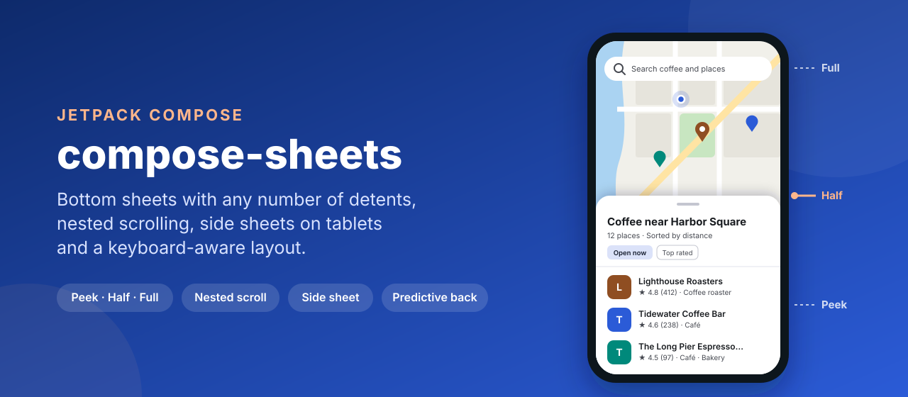
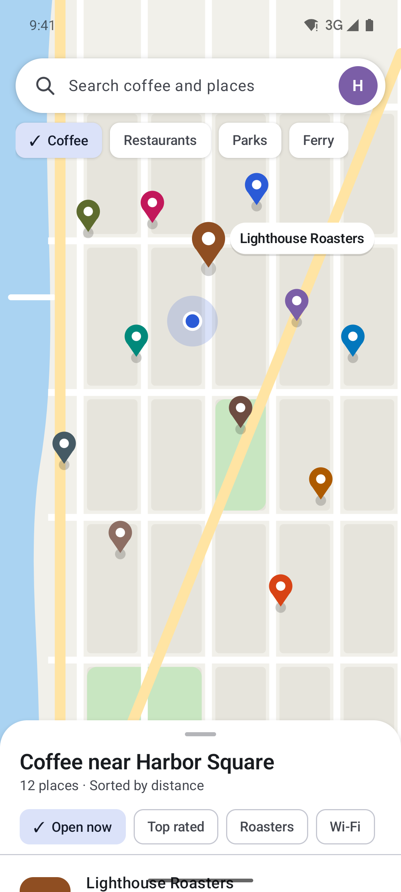
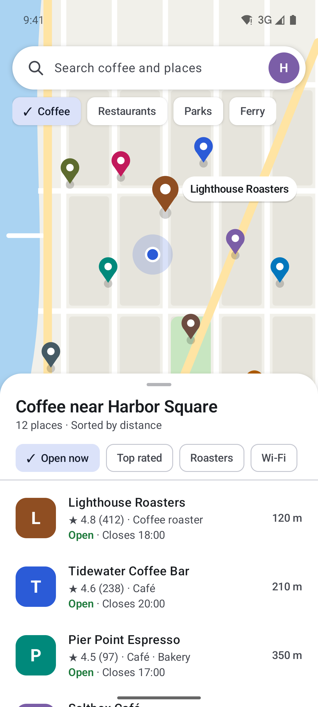
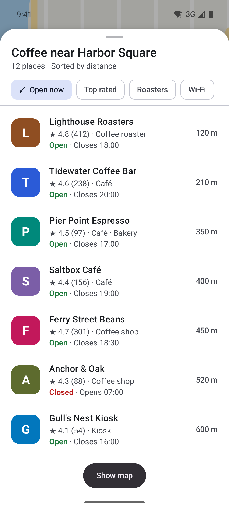
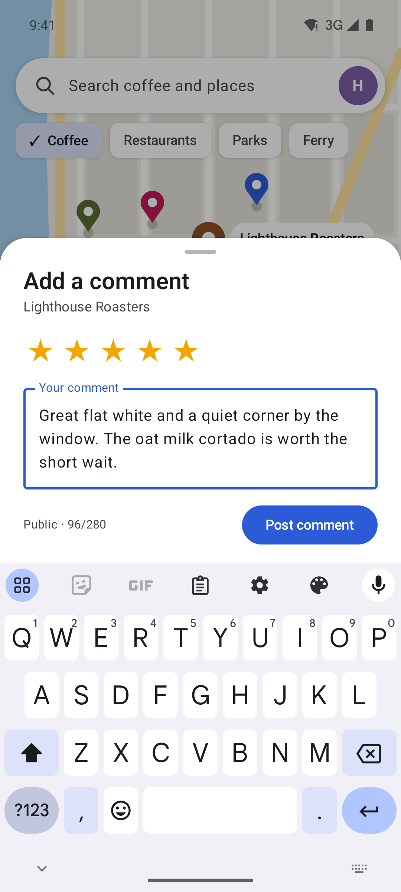
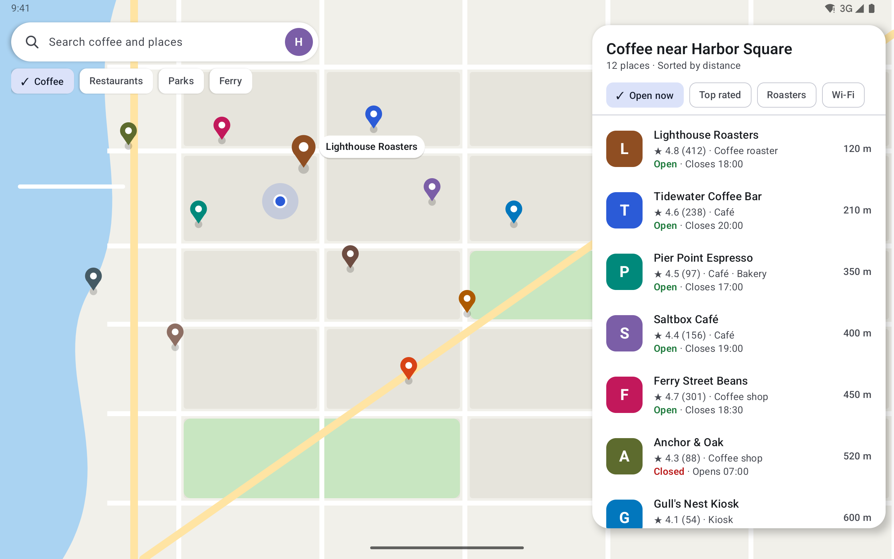

<p align="center">
  
</p>

<p align="center">
  <a href="https://github.com/halilozel1903/compose-sheets/actions/workflows/ci.yml"></a>
  <a href="https://jitpack.io/#halilozel1903/compose-sheets"></a>
  
  
  
  
  <a href="LICENSE"></a>
</p>

**compose-sheets** is a set of bottom sheets for Jetpack Compose with multiple detents, nested scrolling, side sheets on tablets and a keyboard-aware layout. `DetentSheet` rests at any number of detents (a fixed peek height, a share of the screen, or the height of its content) and snaps between them using the release velocity and how far it was dragged, with rubber-banding past the first and last detent. A list inside it scrolls only after the sheet reaches its top detent, and the sheet starts shrinking only after the list is back at its top. It can be modal (scrim, tap outside to close) or persistent like the places sheet in a maps app, where the map behind stays interactive. `AdaptiveSheet` turns into a side sheet on medium and expanded widths. The math lives in a small pure Kotlin core with unit tests.

```kotlin
val state = rememberSheetState(
    detents = listOf(SheetDetent.peek(120.dp), SheetDetent.Half, SheetDetent.Full),
    initialDetent = SheetDetent.Half,
)

Box(Modifier.fillMaxSize()) {
    MapContent()
    DetentSheet(state = state) {           // persistent: the map stays interactive
        Text("Coffee near Harbor Square")
        LazyColumn(Modifier.weight(1f)) { items(places) { PlaceRow(it) } }
    }
}
```

## Screenshots

Captured from the sample app (Waypoint, a fictional maps app) on Android emulators by CI. Each scene starts with the sheet already settled at its detent. The keyboard in the comment sheet screenshot is the emulator's real system keyboard: CI focuses the comment field and captures only once the system reports the keyboard as shown.

| Peek | Half | Full | Comment sheet on the keyboard |
| :---: | :---: | :---: | :---: |
|  |  |  |  |

**Tablet:** on a Pixel Tablet in landscape, `AdaptiveSheet` shows the same places list as a floating side sheet next to the map.



## Features

- **Any number of detents**: `SheetDetent.Fraction` (a share of the available height), `SheetDetent.Fixed` (dp, for a peek height), `SheetDetent.FitContent` (the content's height) and `SheetDetent.Hidden`. Ready-made `Half`, `Full` and `peek(120.dp)`.
- **Snapping**: a fast release moves one detent in its direction; a slow release settles at the next detent once it is past a positional threshold (half way by default, or a fixed distance). `confirmDetentChange` can veto a change.
- **Rubber-banding**: the sheet follows the finger past its first and last detent with growing resistance and springs back.
- **Nested scrolling**: drag a list inside the sheet up and the sheet grows to its top detent before the list scrolls; drag down and the list scrolls to its top before the sheet shrinks. Flings are handed over the same way.
- **Modal or persistent**: modal sheets dim everything behind them and close on a scrim tap or back. Persistent sheets leave the content behind interactive and only dim it on the way to the top detent, like a maps app.
- **Keyboard-aware**: the sheet rests on the keyboard and its detents shrink to the space above it, so a text field at the bottom of the sheet stays visible.
- **Predictive back**: the sheet shrinks with the back gesture; back hides a modal sheet and steps a persistent sheet down one detent.
- **Adaptive**: `AdaptiveSheet` is a bottom sheet on compact widths and a side sheet on medium and expanded widths (`AdaptiveSheetPolicy`), deciding from the width it gets, so it also adapts in split screen. Content can read `LocalSheetPresentation`.
- **Drag handle and accessibility**: tap the Material 3 handle to step through the detents; TalkBack gets expand and collapse actions, and a hidden modal sheet is removed from the accessibility tree.
- **State that survives**: `rememberSheetState` saves the current detent across rotation and process death; `currentDetent`, `targetDetent`, `visibleHeight`, `visibleFraction`, `isAnimating` and `isDragging` are observable.
- **Pure Kotlin core** (`compose-sheets-core`): detent resolution, snapping, rubber-banding, scrim alpha, keyboard-aware heights, nested scroll rules and the bottom or side sheet decision. Unit tested.

## Installation

Add JitPack to `settings.gradle.kts`:

```kotlin
dependencyResolutionManagement {
    repositories {
        google()
        mavenCentral()
        maven("https://jitpack.io")
    }
}
```

Then the dependency:

```kotlin
dependencies {
    implementation("com.github.halilozel1903.compose-sheets:compose-sheets:1.0.0")

    // Pure Kotlin logic only (detents, snapping, rubber-banding, scrim, side sheet decision):
    // implementation("com.github.halilozel1903.compose-sheets:compose-sheets-core:1.0.0")
}
```

> The build is also set up for Maven Central (`io.github.halilozel1903:compose-sheets`) via the vanniktech publish plugin.

## Usage

`DetentSheet` and `AdaptiveSheet` fill their parent and place the sheet at the bottom, so put them last in a `Box` that fills the screen. Use `enableEdgeToEdge()` (or `adjustResize`) and don't add `imePadding()` to a parent; the sheet handles the keyboard itself.

**Persistent sheet with three detents**

```kotlin
val state = rememberSheetState(
    detents = listOf(SheetDetent.peek(160.dp), SheetDetent.Half, SheetDetent.Full),
    initialDetent = SheetDetent.Half,
)
val scope = rememberCoroutineScope()

Box(Modifier.fillMaxSize()) {
    Map()
    DetentSheet(state = state) {
        Header()                                     // visible at the peek detent
        LazyColumn(Modifier.weight(1f)) { /* … */ }   // scrolls after the sheet reaches full
    }
}

// Move it yourself:
scope.launch { state.animateTo(SheetDetent.Full) }
scope.launch { state.stepDown() }                     // also stepUp(), expand(), collapse(), hide(), show(), snapTo()
```

**Modal sheet as tall as its content, on the keyboard**

```kotlin
val state = rememberSheetState(
    detents = listOf(SheetDetent.Hidden, SheetDetent.FitContent),
    initialDetent = SheetDetent.Hidden,
)

DetentSheet(
    state = state,
    modal = true,                                    // scrim, tap outside and back close it
    onDismissRequest = { focusManager.clearFocus() },
) {
    OutlinedTextField(value = comment, onValueChange = { comment = it })
    Button(onClick = { scope.launch { state.hide() } }) { Text("Post comment") }
}

Button(onClick = { scope.launch { state.show(SheetDetent.FitContent) } }) { Text("Comment") }
```

**Side sheet on tablets**

```kotlin
AdaptiveSheet(
    state = state,
    policy = AdaptiveSheetPolicy(sideSheetFrom = WindowWidthClass.Medium),
    sideSheetEdge = SideSheetEdge.End,
) {
    val side = LocalSheetPresentation.current == SheetPresentation.SideSheet
    PlacesList()
}
```

A persistent side sheet floats next to the content; a modal one (`modal = true`) covers the full height with a scrim, closes with a swipe towards its edge, a scrim tap or back.

**Snapping and appearance**

```kotlin
val state = rememberSheetState(
    detents = listOf(SheetDetent.fixed(96.dp, key = "mini"), SheetDetent.Fraction(0.6f, key = "tall")),
    velocityThreshold = 125.dp,                                  // per second
    positionalThreshold = PositionalThreshold.fraction(0.3f),    // or PositionalThreshold.fixed(px)
    animationSpec = spring(dampingRatio = 0.8f, stiffness = 400f),
    confirmDetentChange = { it != SheetDetent.Hidden || canClose },
)

DetentSheet(
    state = state,
    shape = RoundedCornerShape(topStart = 20.dp, topEnd = 20.dp),
    containerColor = MaterialTheme.colorScheme.surface,
    sheetMaxWidth = 560.dp,                          // centered on wider windows
    dragHandle = null,                               // or your own composable
    gesturesEnabled = true,
) { /* … */ }
```

**All `DetentSheet` parameters**

| Parameter | Default | What it does |
| --- | --- | --- |
| `state` | | From `rememberSheetState` |
| `modal` | `false` | Scrim on whenever open, scrim tap and back hide the sheet |
| `onDismissRequest` | `{}` | Called when the sheet settles hidden |
| `sheetMaxWidth` | `640.dp` | Centered and at most this wide |
| `shape`, `containerColor`, `contentColor` | Material 3 | Appearance |
| `tonalElevation`, `shadowElevation` | `1.dp`, `8.dp` | Elevation |
| `scrimColor` | `scrim` at 32% | Scrim at full strength |
| `dragHandle` | `SheetDefaults.DragHandle()` | `null` for none; tap steps through the detents |
| `gesturesEnabled` | `true` | `false` stops drags; programmatic moves still work |
| `topInsets` | `WindowInsets.statusBars` | Kept free above a full sheet |
| `imeInsets` | `WindowInsets.ime` | The keyboard the sheet rests on |
| `contentWindowInsets` | `WindowInsets.navigationBars` | Space below the content when there is no keyboard |

## The core module

`compose-sheets-core` has no Android or Compose dependency. The composables are built on it, and you can use it in tests or other UI toolkits:

```kotlin
val anchors = DetentResolver.resolve(
    detents = listOf(SheetDetent.peek(120f), SheetDetent.Half, SheetDetent.Full),
    availableHeight = SheetLayoutMath.availableHeight(containerHeight = 2400f, topInset = 120f, imeHeight = 0f),
    contentHeight = 0f,
    density = 2.625f,
)                                                    // peek = 315, half = 1140, full = 2280

val config = SnapConfig(velocityThreshold = 330f, positionalThreshold = PositionalThreshold.fraction(0.5f))
SheetSnapper.target(anchors, height = 800f, velocity = 0f, config, startHeight = 315f)     // half: past the threshold
SheetSnapper.target(anchors, height = 400f, velocity = 2000f, config, startHeight = 315f)  // half: a fling

RubberBand.clamp(raw = 2400f, min = 315f, max = 2280f, dimension = 180f)   // about 2328: resists past full
ScrimMath.alpha(height = 1700f, ScrimMath.defaultRange(anchors, modal = false), maxAlpha = 0.32f)  // about 0.16
AdaptiveSheetPolicy().presentation(widthDp = 1280f)                        // SideSheet
```

| API | What it does |
| --- | --- |
| `SheetDetent`, `DetentResolver`, `SheetAnchors` | Detents and their heights for one layout; steps up and down, closest detent |
| `SheetSnapper`, `SnapConfig`, `PositionalThreshold` | Where a released sheet settles, from velocity and position |
| `RubberBand` | Resistance past the edges and its inverse |
| `ScrimMath` | Scrim alpha by sheet height for modal and persistent sheets |
| `SheetLayoutMath` | Available height with the status bar and keyboard, where the sheet sits |
| `SheetNestedScroll` | How a list and the sheet share drags and flings |
| `SheetBackMath` | Predictive back scale |
| `AdaptiveSheetPolicy`, `WindowWidthClass` | Bottom or side sheet by width, side sheet width |

## Sample app

The `sample` module is Waypoint, a fictional maps app: a map of Harbor Square with coffee place pins, a persistent places sheet at peek, half and full (a side sheet on tablets), and a modal comment sheet that opens with the keyboard when you tap a place.

Drags and typing can't be timed reliably through adb, so the sample opens a fixed screen from an intent extra (used by `scripts/screenshots.sh`):

```bash
./gradlew :sample:installDebug
adb shell am start -n io.github.halilozel1903.sheets.sample/.MainActivity --es scene half
```

`scene` is one of `peek`, `half`, `full` (the places sheet at that detent), `keyboard` (the comment sheet with the system keyboard open) or `tablet` (the side sheet). CI captures the phone scenes on a Pixel 7 and `tablet` on a Pixel Tablet in landscape, checks each capture for the screen's text and fails on blank images.

## Project structure

| Module | What it is |
| --- | --- |
| `sheets-core` | Pure Kotlin: detents, snapping, rubber-banding, scrim, layout and nested scroll math, adaptive policy. Published as `compose-sheets-core` |
| `sheets` | Compose: `DetentSheet`, `AdaptiveSheet`, `rememberSheetState`, `SheetDefaults`. Published as `compose-sheets` |
| `sample` | Waypoint, a maps app for phones and tablets, with screenshot scenes |

## Tech stack

Kotlin 2.4 · AGP 9.4 with built-in Kotlin · Gradle 9.6 · Jetpack Compose (BOM 2026.09) · custom `Layout` with `draggable` and `NestedScrollConnection` · `PredictiveBackHandler` · Material 3 · GitHub Actions with Android emulators

## License

MIT. See [LICENSE](LICENSE).
